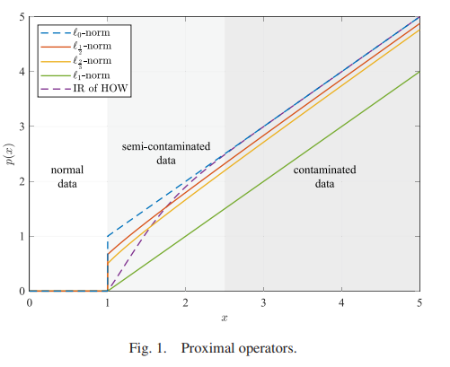
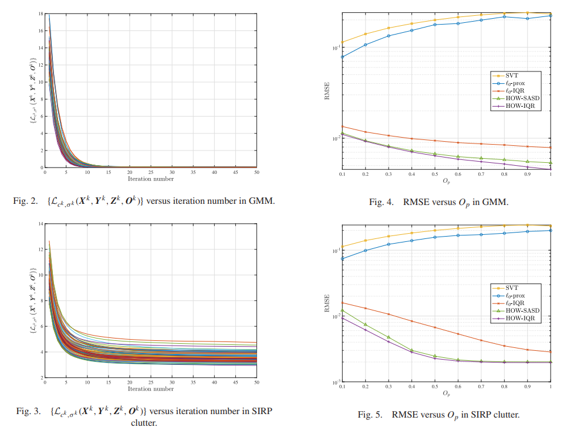
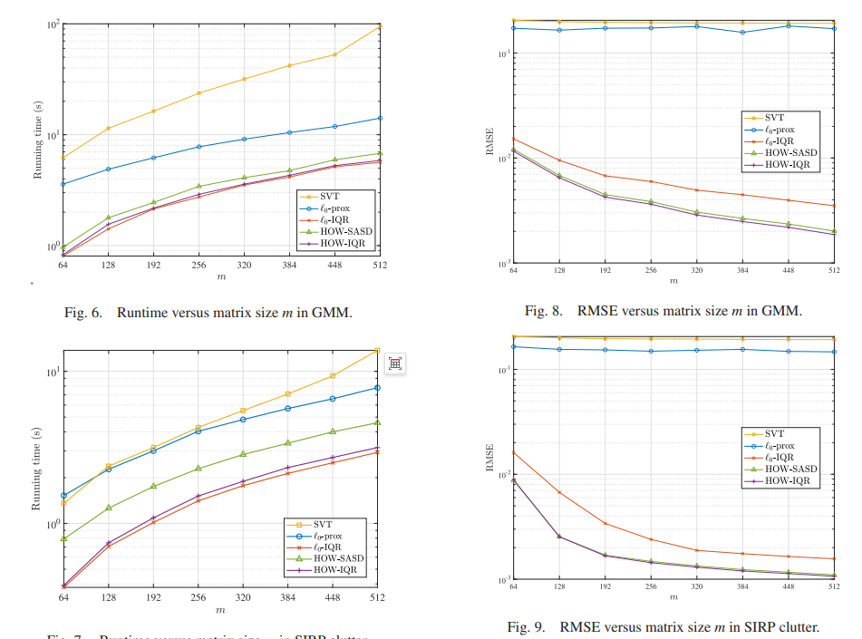
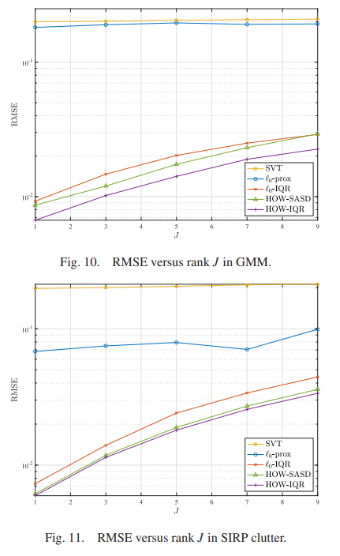
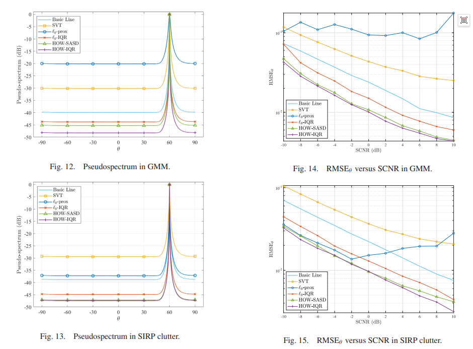

# MIMO Radar - Robust Matrix Completion Method Based on Mixed Orthogonal-Welsch Functions for MIMO Radars [with MATLAB Code]

In this paper, we consider a sub-Nyquist sampling multi-input multi-output (MIMO) radar scenario where observation data is contaminated by pulse non-Gaussian clutter, introducing outliers. To recover missing data, we propose a robust matrix completion (MC) method with an outlier regularization term. This regularization term is generated from a hybrid of the Ordinary-Welsch (HOW) function, characterized by its unbiasedness, sparsity, and continuous solving properties. It aims to classify each measurement value into normal, semi-contaminated, or contaminated states and perform corresponding processing. Subsequently, we employ the Neighborhood Block Coordinate Descent (BCD) algorithm to solve the HOW-based matrix completion problem, and analyze the convergence and computational cost of the proposed algorithm. Experimental results show that, compared to existing methods, our approach exhibits superior performance in terms of matrix completion accuracy, direction of arrival estimation accuracy, and operational time under Gaussian mixture noise and K-distribution clutter environments.
Introduction: Multiple-Input Multiple-Output (MIMO) radar employs multiple transmit and receive antennas to emit diverse waveforms and collect high-resolution signals [1-3]. Compared with traditional single-antenna radar systems, MIMO radar enhances detection and positioning performance significantly through significant spatial diversity enhancement. Specifically, by transmitting orthogonal waveforms that can be separated at the receiving end, waveform diversity is achieved, thereby better distinguishing targets from background noise / clutter. However, as the number of antennas increases, the total number of sampling points inevitably surges. To reduce data volume while maintaining range resolution, methods such as sub-Nyquist MIMO radar [4-7], MIMO radar compression sensing [8-9], and MIMO radar matrix completion (MIMO-MC) [10-14] have been proposed successively. These frameworks effectively reduce the measurement quantity (i.e., the number of antennas or sampling points), but lead to incomplete data. To recover missing entries, MIMO-MC assumes that the number of pulses, receive antennas, and sampling points far exceed the number of targets. Under these assumptions, the noisy received data matrix exhibits low-rank characteristics, allowing for its subset entries to be recovered using low-rank matrix completion [15-19].
MIMO-MC has been studied in the context of additive Gaussian noise and has been applied to improve target detection, estimation, imaging, and positioning performance [20-21]. Sun et al. [11] first proposed this concept, designing two sampling schemes and employing the singular value thresholding (SVT) algorithm for matrix completion. Kalogerias and Petropulu [10] demonstrated the coherence of the data matrix, elucidating the feasibility of matrix completion. However, real-world scenarios can be much more complex. In addition to target echoes, there are also Gaussian distributed thermal noise and non-Gaussian distributed clutter. Unlike Gaussian noise, non-Gaussian clutter exhibits pulse characteristics, with a heavier tail in its probability density function (PDF), meaning that the curve approaches zero at a slower rate, leading to a higher probability of large outlier values. Moreover, although the likelihood of outliers occurring is lower than for normal data, their strength is greater, which explains their description as being pulse-like [22]. Traditional MIMO-MC methods designed for Gaussian backgrounds significantly degrade in performance when non-Gaussian outliers are present.
To address this issue, robustness methods for outlier detection are proposed. Xu et al. [23] addressed the robust MIMO waveform filter design problem through Lagrange duality and proposed a method based on near-end block coordinate descent (BCD) in [24]. Liang et al. [25] used the maximum correlation entropy criterion for target localization, while Singh et al. [26] introduced an estimator based on kernel minimum error entropy. However, these robust methods require complete data and are not suitable for scenarios with missing entries. Liu et al. [27] first noticed this shortcoming and proposed a robust matrix completion method based on l_0 norm under Gaussian Mixture Model (GMM) noise in [27]. The GMM consists of two Gaussian components —— one low power, high probability component for modeling dense noise, and another high power, low occurrence probability component for modeling outliers. However, this commonly used model in robust matrix completion cannot accurately fit the characteristics of real radar clutter. Moreover, the near-end operator of l_0 norm is discontinuous, which may suppress normal data (normal data refers to observations that contain no noise or only Gaussian noise, useful for target information extraction). Additionally, Liu et al. [27] adopted an outlier detection strategy based on complex Laplace kernel, whose kernel parameters are sensitive to large outlier values and significantly degrade the algorithm performance under high Signal-to-Noise Ratio (SCNR). Furthermore, similar to [18,28,29], their matrix variables adopt row-by-row or column-by-column updating strategies, which due to the need to perform m+n times of inverse operations on V ∈C^{m*n} matrices at each iteration, increases complexity.
In this paper, we consider the Yagi-Quast sampling MIMO radar scenario where the received data is contaminated by non-Gaussian clutter and Gaussian thermal noise. We employ the Spherical Invariant Random Process (SIRP) to statistically model the non-Gaussian clutter, and the modulus of the resulting clutter follows a K-distribution. To address the issues mentioned in [27], we adopt a sparse induced regularization term generated from the Mixture of Ordinary - Welsch (HOW) function, which satisfies the properties of being unbiased, sparse, and continuous [30]. Additionally, we propose a new outlier detection strategy and an overall optimization of the matrix completion variables to improve the algorithm's speed.
The main contributions of this paper are as follows:
Firstly, we categorize the observation data into three types: normal data, semi-contaminated data, and contaminated data. The HOW function is used as the loss function to combat outliers because the regularization term generated by HOW retains more target information compared to l_0 norm [27].
Secondly, we adopt a new strategy for adaptively updating the threshold, which is used to judge whether an observation entry is contaminated by outliers, making the algorithm more robust to large outlier values than [27].
Thirdly, we propose a new matrix completion method based on HOW and solve it using the Nearest BCD algorithm. Specifically, to reduce computational costs, we perform an overall update for each matrix variable. Theoretical analysis shows that this approach has lower complexity than column-wise or row-wise updates. Moreover, it proves that the generated sequence is bounded, and any clustering point can be considered as a critical point.
The rest of the paper is structured as follows: Section 2 introduces preliminaries; Section 3 presents the matrix completion method based on HOW and analyzes its convergence and computational complexity; Section 4 provides simulation results; finally, Section 5 summarizes the entire paper.
Figures are not provided in this response.
Conclusion: This paper considers a MIMO radar scenario with data contaminated by non-Gaussian clutter and sampled at sub-Nyquist rates. We propose a robust MIMO-MC method based on the HOW function, and apply the near-end BCD algorithm to solve this problem. The convergence of the proposed algorithm is guaranteed, and its complexity is also discussed. We also explore the impact of parameters such as observation percentage, matrix size, and target number on performance. Benefiting from the unbiasedness, sparsity, and continuity of the near-end operator generated by the HOW function, the proposed method outperforms other MIMO-MC schemes in terms of matrix completion accuracy, direction of arrival estimation accuracy, and running time under Gaussian mixture noise and spherical invariant random process (SIRP) clutter environments.

## Images

<!-- PAYMENT_BLOCK -->

## Get this dataset

- Payment link (Stripe): [Buy now](https://buy.stripe.com/3cs8yP7sY87d0vu9AB)
- Payment QR code: 

<!-- /PAYMENT_BLOCK -->
